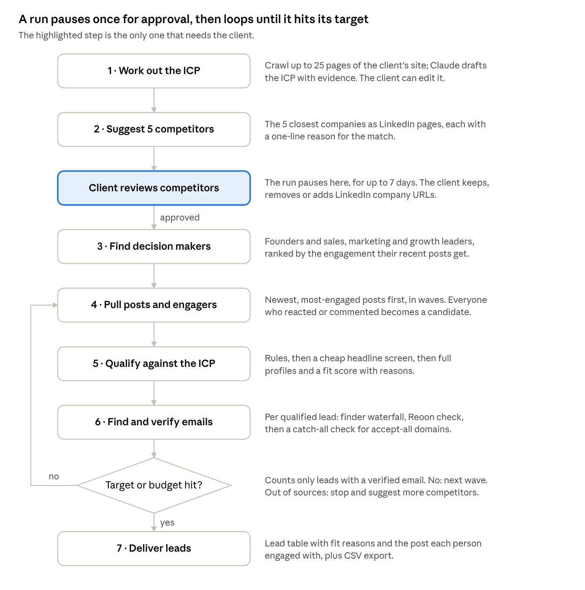
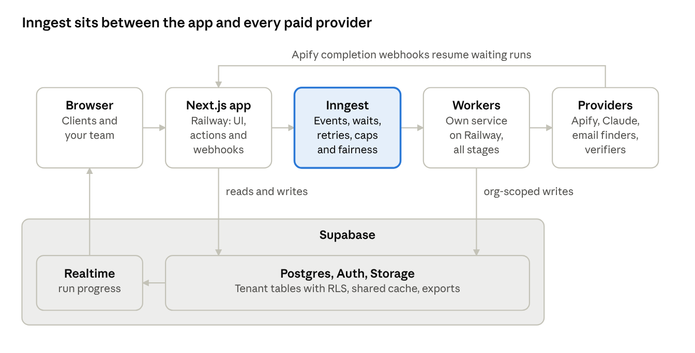
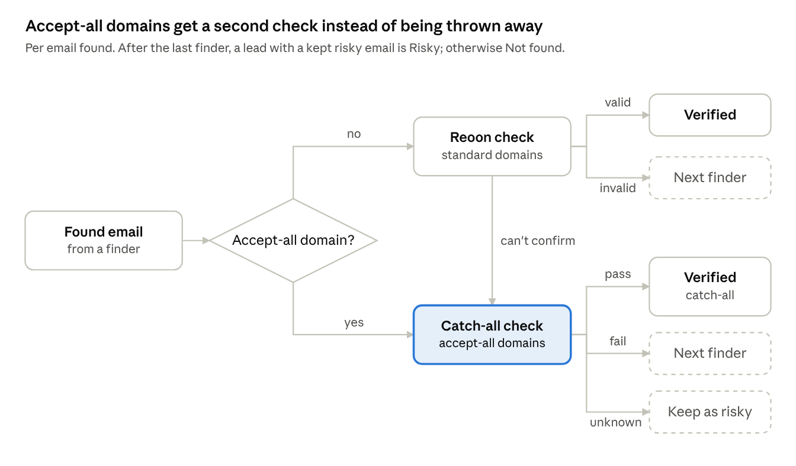
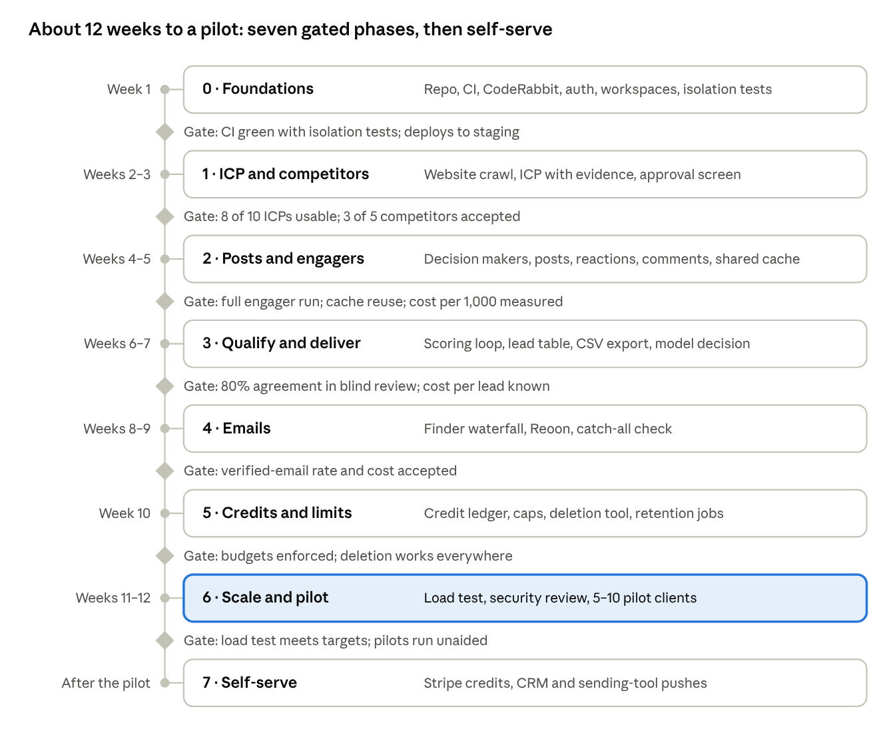

# ICP Lead Engine — Architecture and Build Plan

> Technical copy of the private plan, exported on Oct 23, 2026. Costs, compliance notes and the risk register stay in the private plan because this repository is public.

ICP Lead Engine (working name) is a Next.js app and a worker service on Railway, backed by Supabase, where every lead run is a durable Inngest workflow calling Apify, Claude and an email-finder waterfall. It ships in eight phases: about 12 weeks to a pilot with real clients, then self-serve billing and integrations.

## Decisions this plan rests on

These five defaults were agreed on Oct 23, 2026 and shape everything below.

| Question | Decision |
| --- | --- |
| Who are the leads? | People who react to or comment on posts by competitors' decision makers |
| Why emails fail today | Handle both causes: a waterfall of 2–3 finders first, then a catch-all check and a "risky" bucket |
| Scale target | 10k registered accounts, a few hundred runs in flight at peak |
| Who pays providers | Your Apify, Reoon and Claude accounts; clients spend credits |
| Output | Lead table and CSV export first; CRM and sending-tool integrations later |

Two kinds of users share one app: your team, who can work in any client workspace, and clients, who see only their own.

Production grade here means six guarantees:

- No run is lost or charged twice, even when a provider fails halfway.
- One client can't slow the others down, and no provider limit is exceeded.
- Every run has a known cost and a hard budget.
- Each client sees only its own data, proven by tests on every change.
- A broken scraper is caught the same day and swapped without touching the pipeline.
- Personal data has retention limits and can be deleted on request.

Out of scope for v1: sending emails or LinkedIn messages, enterprise SSO and mobile apps.

## How a run works

A run needs the client once, to approve competitors; after that it loops on its own until it reaches the lead target or the budget.

Each box is one Inngest function, and the arrow from the target check back to stage 4 is the wave loop described under Pipeline stages.

## System architecture

The web app only takes requests and shows results. Every long-running or paid step runs as an Inngest workflow, so the app stays fast however many runs are in flight.

Clients never wait on a provider: the app records the request, Inngest runs the steps, and progress streams back over Realtime. The browser reaches Supabase directly only for sign-in and Realtime.

| Piece | Why this one |
| --- | --- |
| Next.js on Railway | One TypeScript codebase for UI, server actions and webhooks, run as a long-lived Railway service with an environment per pull request |
| Supabase | You already use it; Postgres row-level security isolates workspaces; Auth, Realtime and Storage come with it |
| Inngest | Durable steps, waits that hold no capacity (competitor approval, Apify callbacks) and concurrency caps that can be shared across functions ([docs](https://www.inngest.com/docs/guides/concurrency)) |
| Apify | You already use it; maintained LinkedIn and website actors, with completion webhooks |
| Claude | ICP extraction, competitor ranking and lead scoring, returning structured JSON |
| Reoon plus a catch-all checker | Reoon for standard verification; a specialist for accept-all domains |

Why a separate worker service: on Railway the worker is a long-lived process that connects out to Inngest ([Inngest Connect](https://www.inngest.com/docs/setup/connect)), so its steps aren't bound by HTTP timeouts and it scales by adding replicas. Supabase Edge Functions, by contrast, stop after 400 seconds on paid plans ([limits](https://supabase.com/docs/guides/functions/limits)), while a run takes up to hours and may wait days for approval. A run can last up to 90 days on Inngest Pro.

## Pipeline stages

Each stage is one Inngest function: it reads its input from Postgres, calls one provider through an adapter, writes normalized rows and triggers the next stage. Every actor below works without a LinkedIn login.

| Stage | Provider | Input → output | If it fails |
| --- | --- | --- | --- |
| 1. ICP | [Website Content Crawler](https://apify.com/apify/website-content-crawler) (fast HTML mode, max 25 pages) + Claude | Website → ICP JSON with evidence quotes | Retry; fall back to the homepage alone; the client can write the ICP by hand |
| 2. Competitors | Claude + [linkedin-company](https://apify.com/harvestapi/linkedin-company) and [linkedin-company-search](https://apify.com/harvestapi/linkedin-company-search) | ICP and site → 5 ranked LinkedIn company pages | Show fewer suggestions; the client adds URLs |
| 3. Decision makers | [linkedin-company-employees](https://apify.com/harvestapi/linkedin-company-employees) (short mode, seniority filter) + [linkedin-profile-posts](https://apify.com/harvestapi/linkedin-profile-posts) for an activity check | Competitor pages → 3–5 active posters each, plus the company page | Skip a competitor with no active posters and tell the client |
| 4. Posts and engagers | linkedin-profile-posts and [linkedin-company-posts](https://apify.com/harvestapi/linkedin-company-posts), then [linkedin-post-reactions](https://apify.com/harvestapi/linkedin-post-reactions) and [linkedin-post-comments](https://apify.com/harvestapi/linkedin-post-comments) | Posters → recent posts → engagers with headline and engagement context | Retry the batch; switch to a backup actor; reuse cached posts |
| 5. Qualify | Rules → Claude on headlines → [linkedin-profile-scraper](https://apify.com/harvestapi/linkedin-profile-scraper) → Claude fit score | Engagers → leads tiered A, B or C with reasons | Retry the batch; stop at the budget |
| 6. Emails | Finder waterfall → Reoon → catch-all checker | Leads → email and status | Next finder; else "risky" or "not found" |
| 7. Deliver | Postgres and Storage | Leads → table and CSV | Regenerate the export |

**ICP.** Claude extracts industries, company size band, regions, business model, buyer personas (titles, seniority, functions), exclusions, pains and buying triggers. Each claim carries an evidence quote and the page it came from. Every edit makes a new version, and a run pins the version it used.

**Competitors.** Candidates come from Claude reading the site, LinkedIn's similar-companies data and companies Claude knows in the category. Each is resolved to a LinkedIn page and ranked on offering overlap, ICP overlap and size. The run waits up to 7 days for approval, then expires without charging for later stages.

**Decision makers.** The search covers founders, CEO, CRO, CMO and heads of sales, marketing, growth and product, plus titles that match the client's buyer persona. Each candidate's last 5 posts are checked, and per competitor the 3–5 people whose posts draw the most engagement are kept.

**Engager waves.** Posts are processed newest and most-engaged first. Emails are found as each lead qualifies, and only leads with a verified email count toward the target. After each wave the run computes its yield (deliverable leads ÷ engagers screened) and sizes the next wave to close the gap. It stops at the target, at the budget, or when sources run out, and then suggests adding competitors.

**Qualification funnel**

1. Rules, free: drop the competitors' and the client's own employees, suppressed people, leads already delivered to this workspace, and obvious non-buyers such as students, recruiters and job seekers.
2. Headline screen: Claude scores about 100 headlines per call against a cached ICP prompt. Reaction and comment rows already carry the headline, so this step needs no extra scraping.
3. Enrich: a full profile for survivors only; company data comes from the cache when it can.
4. Fit score: Claude returns tier A, B or C with reasons and disqualifiers. A and B are delivered by default.

Every lead keeps its engagement context (the post, the reaction or comment text, and the date), so outreach can reference it.

**One identity check for phase 2.** Reaction and comment rows identify people by an internal LinkedIn member ID, not a public profile URL. That ID is the one person key: vanity URLs from profiles map to it, and dedupe and suppression both use it. Phase 2 must confirm the profile scraper accepts it; if not, survivors of the headline screen get standard URLs for an extra $2 per 1,000.

**Model choice.** The default is Claude Opus 5.5 for every stage. Phase 3 compares it with Claude Haiku 5.5 on the two bulk stages (the headline screen and the fit score) on real data before deciding.

**A shortcut to test in phase 2.** [linkedin-post-search](https://apify.com/harvestapi/linkedin-post-search) filters posts by company and author title in one call and returns reactions and comments inline. It could replace stages 3 and 4 for some runs, but its authors can include ex-employees, so it needs a filter.

## Email finding and verification

The flow tackles both causes of weak results. Each lead gets up to three finders before it counts as not found, and accept-all domains get a second check instead of being discarded.

Domain status (mail provider, accept-all or not) is cached for 30 days, so a known accept-all domain skips Reoon and goes straight to the catch-all check.

**Finder order** (the phase 4 bake-off confirms it). Each finder is charged only when it returns an email.

| Step | Finder | Price per email found | Why it's here | Terms for a multi-tenant product |
| --- | --- | --- | --- | --- |
| 1 | [Findymail](https://www.findymail.com/pricing/) | $0.0198 at 5K, down to $0.0085 at 100K | Verifies before returning; top quality and coverage in [Clay's 2025 tests](https://www.clay.com/data-tests/best-work-email-provider-by-region-2025); LinkedIn lookup when name and domain miss | Credit plans allow embedding and resale |
| 2 | [Icypeas](https://www.icypeas.com/legal/terms-of-service) | $0.019 at 1K, down to $0.005 at 100K | Certainty grade on every result; we accept only the top two grades | Terms allow resale inside your own product |
| 3 | [Anymail Finder](https://anymailfinder.com/pricing) | $0.02 at 10K a month; packs from $0.0109 to $0.005 | Stays only if it adds yield in the bake-off | [Terms](https://anymailfinder.com/legal/terms-of-service) allow products for your own users |

Left out for now: [Apollo](https://www.apollo.io/terms/) (its terms bar third-party API access), and [LeadMagic](https://leadmagic.io/legal/terms), [Prospeo](https://prospeo.io/terms-of-service) and [Enrow](https://enrow.io/en/legal/terms-and-conditions), which need a signed resale deal first. The Apify profile scraper's bundled email (+$6 per 1,000 profiles) also enters the bake-off, pending its terms.

**What happens with each Reoon result** ([status meanings](https://www.reoon.com/articles/meaning-of-different-email-verification-statuses/))

| Reoon result | Meaning | Action |
| --- | --- | --- |
| safe | The mailbox exists | Verified |
| role\_account | A shared mailbox such as sales@ | Verified, flagged as a role address |
| catch\_all | The domain accepts any address | Catch-all check |
| unknown | No definite answer; not charged | Catch-all check |
| inbox\_full | A real mailbox over its quota | Kept as risky; re-checked once after the run |
| invalid, disabled, disposable, spamtrap | Bad or dangerous | Drop it and try the next finder |

The catch-all check uses [BounceBan](https://bounceban.com/pricing). It sends no email and claims to resolve 85–95% of accept-all addresses at over 97% accuracy (a vendor claim to test in the bake-off). It returns results by webhook and costs $0.004 to $0.0017 per check. [Scrubby](https://docs.scrubby.io/llms-full.txt)'s deep mode sends real probe emails and takes 24–72 hours, too slow for a run.

| Final status | Meaning | In the default export | Client charged |
| --- | --- | --- | --- |
| Verified | Reoon confirmed the mailbox | Yes | Yes |
| Verified, catch-all | Accept-all domain that passed the catch-all check | Yes | Yes |
| Risky | Accept-all or unresolved; kept with a score | Only if the client opts in | No |
| Not found | No finder returned a verified or risky email | No | No |

**Throughput.** Reoon's single-check API allows about 5 parallel requests, and its bulk tasks run one at a time ([API docs](https://www.reoon.com/articles/api-documentation-of-reoon-email-verifier/)). So checks from all runs are batched into bulk tasks of up to 50,000, which clear about 1,000–1,500 a minute, far above the \~60k a day the load model needs. Checks that finish after a run ends update the lead later; a lead that verifies then is added to the export and charged then.

**Bake-off in phase 4.** Take 1,000–1,500 leads, mixed across accept-all and normal domains, regions and company sizes. Labels come from 200–300 people with known-good emails (past replies), plus invented names on the same accept-all domains, where any "valid" is a false positive. Every finder runs on identical inputs, raw responses are stored, and waterfall orders are simulated offline. The scorecard: find rate, bounce rate, accept-all resolution, extra yield per step and cost per valid email.

## Data model

Data lives in two zones: tenant tables that only the owning workspace can read, and a shared cache of public LinkedIn data that only the background workers touch.

**Tenant tables** (row-level security on org\_id)

| Table | Holds | Kept for |
| --- | --- | --- |
| organizations, memberships | Workspaces, members and roles | Life of the account |
| icps, icp\_versions | The ICP per website; every edit is a new version | Life of the account |
| runs | Settings, status, counters, budget and stop reason per run | Life of the account |
| run\_competitors | Suggested, approved, rejected and added competitors | Life of the account |
| run\_candidates | Every engager screened in a run, with scores and reasons | 90 days; leads keep their own copy |
| leads | Qualified people: fit tier, reasons, email, email status, engagement context | Life of the account |
| exports | Generated CSV files | Files expire after 7 days |
| credit\_ledger | Every credit grant, hold, charge and release | Permanent |
| suppression | Emails, domains and profiles a client never wants delivered | Life of the account |
| audit\_log | Staff access, exports, deletions and credit changes | 2 years |

**Shared cache** (workers only; clients never query it directly)

| Table | Holds | Refreshed or pruned |
| --- | --- | --- |
| companies | LinkedIn company pages: name, domain, industry, size, HQ | Re-fetched when older than 30 days |
| people | LinkedIn profiles: name, headline, current role and company | Re-fetched when older than 60 days; deleted after 12 months unused |
| posts | Posts by tracked authors, with reaction and comment counts | Engagers re-pulled after 72 hours, only for posts under 14 days old |
| post\_engagements | Who reacted to or commented on each post | Monthly partitions, dropped after 90 days |
| emails, email\_checks | Found emails and every verification result | Re-verified when older than 30 days; deleted after 12 months unused |
| domains | Mail provider and catch-all status per domain | Re-checked after 30 days |
| provider\_calls | Every paid call: provider, run, items and cost in USD | Permanent |
| global\_suppression | Hashes of people who asked to be deleted | Permanent |

- Leads are unique per workspace and person (keyed by LinkedIn member ID), so a client never receives the same person twice; suppression uses the same key.
- A lead row copies the cached fields it needs, so tenant policies never reach into the shared cache.
- post\_engagements and run\_candidates are partitioned by month from the day they are created, so old months are dropped whole.
- Raw provider responses go to object storage for 30 days for debugging, not into Postgres.
- Retention periods are starting defaults; confirm them with counsel before launch.

## Security and tenancy

Each workspace's data is walled off by the database itself, not just by app code, and those rules are tested on every pull request.

| Role | Who | Can |
| --- | --- | --- |
| Staff admin | Your team | Everything in every workspace; grant credits; manage providers |
| Staff support | Your team | Read any workspace to help a client; every access is logged |
| Owner | Client | Members and billing, plus everything an admin can do |
| Admin | Client | Create runs, edit ICPs, approve competitors, export |
| Member | Client | Create runs and view leads; export if the owner allows |

**Controls**

- Row-level security on every tenant table checks both the workspace and the member's role. Exports run through a server function that checks the role and logs each export. Staff get time-limited access grants to a workspace, logged when granted and when used.
- Background workers don't use the service key for tenant data. They connect as a worker role whose policies require the job's org\_id; only the shared cache is open across workspaces, and isolation tests cover this path too.
- Sign-in uses Supabase Auth with email links and Google. Staff accounts require MFA; SAML single sign-on can come later for enterprise clients.
- Provider keys and the service key live only in Railway and Inngest settings; nothing secret reaches the browser. The browser talks to Supabase directly only for sign-in and Realtime, on private channels per workspace.
- Apify callbacks carry a per-run secret and are re-checked against the Apify API before the pipeline trusts them. Stripe callbacks are signature-checked.
- Credit holds stop runaway spend, and run creation is rate-limited per workspace.
- Production has point-in-time recovery, with a restore drill before launch.

## Scale and cost control

At 10k accounts the limits are provider capacity and spend, not web traffic, so every paid call goes through one shared limiter and one ledger.

**Load model** (assumptions to recalibrate in the pilot): 10k registered accounts, 30% active in a month, 2 runs each. That is about 6,000 runs a month, a few hundred in flight at peak, and up to \~95M engagement rows a month before cache reuse.

| Limit | Value today | How the design handles it |
| --- | --- | --- |
| Apify concurrent actor runs | 32 on Starter (your plan), 128 on Scale, 256 on Business ([limits](https://docs.apify.com/platform/limits)) | Starts beyond the limit fail, so an account-wide Inngest cap sits just under it, and inputs from many runs are batched into one actor run |
| Inngest concurrent steps | 100 on Pro, 500 on Business ([pricing](https://www.inngest.com/pricing)) | Waiting runs hold no slot; move to Business before public launch |
| Inngest batch size | 100 events on Pro, 500 on Business ([batching](https://www.inngest.com/docs/guides/batching)) | Profile and engagement requests from many runs merge into one actor run every few seconds |
| Claude rate limits | Set by the account's usage tier | About 100 headlines per call, a cached ICP prompt and a global throttle |
| Reoon and finder rate limits | Per vendor | A throttle per provider and bulk endpoints |
| Postgres writes | Grow with engagement volume | Batched upserts of 500–1,000 rows, monthly partitions, counters updated per batch |
| Realtime | Postgres Changes checks every event against every subscriber, on one thread ([docs](https://supabase.com/docs/guides/realtime/postgres-changes)) | Progress goes out as Broadcast messages per run, at most one every 2 seconds |

**Fairness.** Admission happens in Postgres, not Inngest, because Inngest caps executing steps rather than runs. Each workspace has 2 active-run slots on standard plans; extra runs wait as queued and show an ETA. Higher plans get more slots and go first.

**Credits.** A client is charged once per delivered lead: qualified and with a verified email. Because clients pay for outcomes, not attempts, our own provider spend needs caps of its own.

- A run's budget is held when it starts, and each qualified lead reserves its expected email cost, so a run never qualifies leads it can't afford to finish.
- Each run also has a provider-cost limit. If yield falls far below plan, the run stops early and asks the client to widen the ICP or add competitors.
- Backstops from phase 0: Apify's per-run charge cap, a spend limit on every vendor account, a per-workspace daily cap and a global daily spend alarm.
- Every ledger entry carries an idempotency key, so a retry never charges twice.

**Shared cache.** Competitor posts, engagers, profiles and companies are reused across clients while fresh. With many clients in similar markets, this is the biggest cost lever.

## Reliability and observability

Every step can fail and retry without side effects, and every failure reaches a dashboard or an alert within minutes.

- Steps retry with exponential backoff. Errors are classed as retryable (timeouts, rate limits, 5xx) or permanent (bad input), and permanent ones fail fast with a clear message.
- Each paid item (a post, a profile, an email lookup) is keyed by run and item, and a shared actor run's cost is split across the items it served. A retried step reuses stored results instead of paying twice. Credit ledger entries carry unique keys too.
- Apify runs start with a completion webhook. The workflow waits with a 5-minute timeout and checks the run's status on each timeout, which also catches a webhook that lands before the wait begins. Cancelling a lead run drops its pending items; a shared actor run is aborted only when no other run needs it.
- Each provider adapter has a circuit breaker: past an error-rate threshold, that stage pauses for everyone, staff are alerted, and runs resume or switch to the backup actor.
- Every provider response is validated against a schema, so a changed format fails loudly instead of writing bad data.
- A nightly canary pushes one tiny job through every provider (one company, one post, a few engagers, two emails) to catch LinkedIn-side breakage before clients do.
- Claude calls handle the refusal stop reason. Opus 5.5 uses the API's server-side fallback; Haiku 5.5 has none, so if the bulk stages move to it, a refused batch is retried on Opus 5.5.
- Logs go to a log drain such as Axiom, tagged with run and workspace IDs and never containing emails.

| Signal | Where | Alert when |
| --- | --- | --- |
| App and worker errors | Sentry | A new error type appears, or the error rate spikes |
| Workflow health | Inngest dashboard | Failure rate above 2%, or queued work older than 10 minutes |
| Provider health | Staff admin, from provider\_calls | A provider's error rate stays above 10% for an hour, or its yield (engagements per post, emails per lead) falls 50% below the 7-day average |
| Spend | Staff admin | Daily spend above 150% of the 7-day average |
| Database | Supabase reports | CPU above 70% or connections above 80% for 10 minutes |

Starting targets: 99.9% app uptime, 95% of runs finishing without staff help, and a 200-lead run finishing within 2 hours. The pilot will recalibrate them.

## Engineering workflow

One public GitHub monorepo, [sdsouza133/icp-lead-engine](https://github.com/sdsouza133/icp-lead-engine), and three environments, plus a preview per pull request. Every change goes through a pull request that CI and CodeRabbit must pass. Because the repo is public, secret scanning with push protection stays on, and keys live only in Railway and Inngest settings.

| Path | Holds |
| --- | --- |
| apps/web | Next.js app: UI, server actions and webhooks |
| apps/worker | Inngest Connect worker that runs every pipeline function |
| packages/pipeline | Inngest functions: the run orchestrator and one function per stage |
| packages/providers | Adapters for Apify, Claude, email finders, Reoon and the catch-all checker, each with a fake |
| packages/core | Domain logic: ICP schema, scoring rules, dedupe and credit math |
| packages/db | Generated Supabase types and org-scoped queries |
| supabase/ | Migrations, seed data and row-level security tests |
| .github/workflows/ | CI pipelines |
| .coderabbit.yaml | CodeRabbit review rules |
| .railway/railway.ts | Railway services (web and worker) as code |

| Environment | Database | Workflows | Hosting | Providers |
| --- | --- | --- | --- | --- |
| Local | Supabase CLI in Docker | Inngest dev server | Your machine | Fakes by default |
| Preview, per pull request | Supabase preview branch | Inngest branch environment | Railway PR environment | Fakes |
| Staging | Its own Supabase project | Inngest staging | Railway | Real, with low limits |
| Production | Its own Supabase project with point-in-time recovery | Inngest production | Railway | Real |

**CI on every pull request** (GitHub Actions), in order: lint, typecheck, unit tests, database tests (start Supabase, apply every migration, run the row-level security tests), workflow tests with mocked steps, build, then a Playwright smoke test against the preview. A merge to main needs green CI and every CodeRabbit comment resolved.

**CodeRabbit path rules** (.coderabbit.yaml)

- supabase/migrations: every new table enables row-level security, has policies and a test; no destructive change without a backfill plan.
- packages/providers: timeouts, retries, response validation and cost reporting on every call; no personal data in logs.
- packages/pipeline: steps are idempotent, carry concurrency keys and check the run budget.
- apps/web: no service key in client code; every server action checks membership.

| Test layer | Tool | Proves |
| --- | --- | --- |
| Unit | Vitest | Scoring, dedupe, waterfall logic and credit math |
| Provider contracts | Recorded fixtures | Each adapter parses real responses, with no live calls in CI |
| Database | pgTAP | Workspace A can never read workspace B |
| Workflows | Inngest test helpers | Step order, retries, waits and budget stops |
| End to end | Playwright | Sign in, run, approve competitors, see leads, export |
| Load | k6 with fake providers | 300 runs in flight, database write rate, fairness between clients |

**Releases**: a merge to main deploys staging automatically once GitHub checks pass; production is a manual promote after staging checks. Migrations stay backward-compatible and run before the code that needs them. Per-workspace feature flags roll out new stages and providers gradually. This file is a technical copy of the private plan, and CLAUDE.md records the conventions Claude Code follows.

## Build plan

Eight phases: about 12 weeks to a pilot with 5–10 real clients, then self-serve billing and integrations. Each phase ends at a gate, and the next starts only when it passes. Durations assume one developer working full-time with Claude Code and are re-estimated after phase 1.

The highlighted phase ends in the pilot launch; the checklists below are the work inside each phase.

### Phase 0 — Foundations (week 1)

- [ ] GitHub repo, monorepo scaffold, CI and CodeRabbit rules
- [ ] Staging and production Supabase projects, Railway services, Inngest, Sentry and an Anthropic API key, with a spend limit on every provider account
- [ ] Auth, workspaces, memberships, roles and row-level security, with isolation tests
- [ ] Provider adapter interface, fake providers and the provider\_calls cost ledger
- [ ] App shell: dashboard, workspace switcher and a staff admin stub

Gate: a user signs in to their own workspace, CI is green including isolation tests, and a merge deploys to staging.

### Phase 1 — ICP and competitors (weeks 2–3)

- [ ] Run form: website, target lead count, budget, regions and exclusions
- [ ] Website crawl and ICP extraction with evidence; ICP editor with versions
- [ ] Competitor discovery, ranking and the approval screen; the run waits for approval
- [ ] Live run progress over Realtime broadcast

Gate: on 10 real client websites, your team rates at least 8 ICPs usable and accepts at least 3 of 5 suggested competitors on average.

### Phase 2 — Decision makers, posts and engagers (weeks 4–5)

- [ ] Decision-maker search and posting-activity ranking, plus competitor company pages
- [ ] Posts, reactions and comments collected through the shared cache, in monthly partitions from day one
- [ ] Apify webhooks with timeout checks, batching across runs, a backup actor per stage and the nightly canary
- [ ] Cost recorded per stage

Gate: a run collects engagers for 5 competitors end to end, a second run on the same competitors reuses the cache, and cost per 1,000 engagers is measured.

### Phase 3 — Qualification and lead delivery (weeks 6–7)

- [ ] Rules filter, headline screen, enrichment and fit scoring with reasons
- [ ] The wave loop: stop at the target, the budget or when sources run out
- [ ] Lead table, lead detail with engagement context, CSV export
- [ ] Side-by-side test to decide the model for the two bulk stages

Gate: in a blind review of 5 real runs, your team agrees with at least 80% of A and B leads, and cost per qualified lead is known.

### Phase 4 — Emails (weeks 8–9)

- [ ] Bake-off of 3–4 finders and a catch-all checker on a labelled sample of known emails
- [ ] Waterfall, Reoon verification, catch-all step and final statuses; the run target now counts only leads with a verified email
- [ ] Domain, email and verification caches

Gate: verified-email rate and cost per verified email are measured on 5 runs and accepted by you.

### Phase 5 — Credits, limits and compliance tools (week 10)

- [ ] Credit ledger with holds, charges and releases; plan limits; staff credit grants; usage page
- [ ] Run admission with per-workspace slots, a provider-cost limit per run and daily spend caps
- [ ] Suppression lists, the deletion tool, retention jobs and an audit log view
- [ ] Lead feedback buttons that feed scoring examples

Gate: tests prove no run can exceed its budget and a deletion request removes a person everywhere.

### Phase 6 — Scale hardening and pilot (weeks 11–12)

- [ ] Load test with 300 runs in flight on fake providers; tune caps to provider plans
- [ ] Tune partitions and indexes; upgrade Supabase compute, Apify and Inngest plans as needed
- [ ] Row-level security review, a restore drill, runbooks and alerts
- [ ] Onboard 5–10 pilot clients

Gate: the load test meets the reliability targets, and pilot clients complete runs without staff help.

### Phase 7 — Self-serve and integrations (after the pilot)

- [ ] Stripe self-serve credits and subscriptions
- [ ] Push leads to CRMs and sending tools, plus outbound webhooks
- [ ] Bounce feedback from sending tools into provider scoring
- [ ] More lead sources: any LinkedIn creator, not just competitors

## Sources

Pages opened on Oct 23, 2026. Prices and terms change, so re-check them before launch. Accuracy figures are vendor claims or vendor-run tests.

- Infrastructure: [Inngest concurrency](https://www.inngest.com/docs/guides/concurrency) · [Inngest batching](https://www.inngest.com/docs/guides/batching) · [Inngest flow control](https://www.inngest.com/docs/guides/flow-control) · [Inngest Connect](https://www.inngest.com/docs/setup/connect) · [Inngest v3 to v4 migration](https://www.inngest.com/docs/reference/typescript/v4/migrations/v3-to-v4) · [Inngest pricing](https://www.inngest.com/pricing) · [Supabase Edge Function limits](https://supabase.com/docs/guides/functions/limits) · [Supabase Realtime: Postgres Changes](https://supabase.com/docs/guides/realtime/postgres-changes) · [Railway monorepo guide](https://docs.railway.com/guides/monorepo) · [Railway infrastructure as code](https://docs.railway.com/infrastructure-as-code) · [Claude pricing](https://platform.claude.com/docs/en/about-claude/pricing)
- Apify: [platform limits](https://docs.apify.com/platform/limits) · [plans and pricing](https://apify.com/pricing) · the actor pages linked under Pipeline stages
- Email: [Reoon API](https://www.reoon.com/articles/api-documentation-of-reoon-email-verifier/) · [Reoon statuses](https://www.reoon.com/articles/meaning-of-different-email-verification-statuses/) · [Reoon pricing](https://emailverifier.reoon.com/#pricing) · [BounceBan docs](https://bounceban.com/public/doc/llms-full.txt) · [BounceBan pricing](https://bounceban.com/pricing) · [Scrubby docs](https://docs.scrubby.io/llms-full.txt) · [Findymail API](https://app.findymail.com/docs/) · [Findymail pricing](https://www.findymail.com/pricing/) · [Icypeas API](https://api-doc.icypeas.com/) · [Icypeas terms](https://www.icypeas.com/legal/terms-of-service) · [Anymail Finder pricing](https://anymailfinder.com/pricing) · [Anymail Finder terms](https://anymailfinder.com/legal/terms-of-service) · [Clay catch-all verifier test](https://www.clay.com/data-tests/best-catchall-email-verifiers-2025) · [Clay work-email test](https://www.clay.com/data-tests/best-work-email-provider-by-region-2025)
